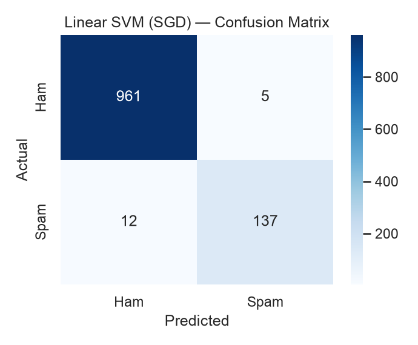
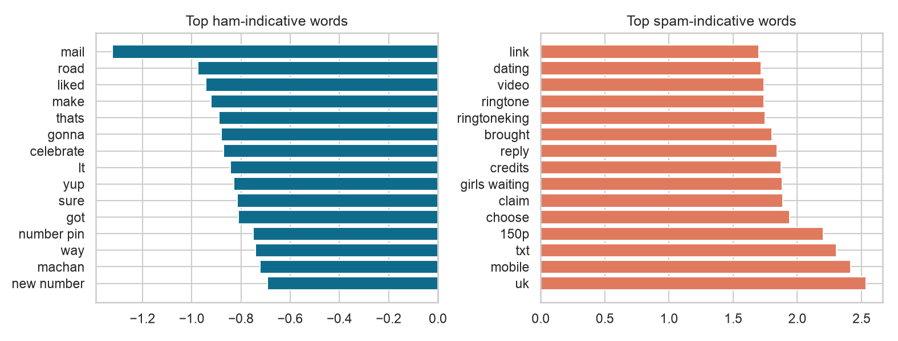

# 📧 SMS Spam Classifier

Classic NLP classification project: detect **spam SMS messages** using TF-IDF features and three
classic classifiers, with a local Streamlit demo. Trained and evaluated on the
[UCI SMS Spam Collection](https://archive.ics.uci.edu/ml/datasets/SMS+Spam+Collection)
(Almeida et al., 2011) — **5,574 real SMS messages** (13.4% spam).

---

## Run the Streamlit app locally

```bash
pip install -r requirements.txt
streamlit run app/app.py
```

Type any message (or pick an example) and get an instant **spam/ham verdict with probability**.

---

## 📈 Results

| Model | Accuracy | Precision | Recall (spam) | F1 | ROC-AUC | 5-fold CV F1 |
|---|---|---|---|---|---|---|
| Naive Bayes | 97.8% | 98.4% | 84.6% | 0.910 | 0.991 | 0.92 ± 0.01 |
| Logistic Regression | 97.9% | 99.2% | 84.6% | 0.913 | 0.991 | 0.89 ± 0.03 |
| **Linear SVM (SGD)** | **98.5%** | **96.5%** | **92.0%** | **0.942** | **0.992** | **0.94 ± 0.01** |



**Winner: Linear SVM** — it catches **92% of all spam** (vs 84.6% for the others) while keeping real
messages safe. In spam filtering the metric that matters is **recall on the spam class**, which the
margin-based SVM handles best.



---

## 🧠 What the model learned

Top spam-indicative terms: `free`, `txt`, `claim`, `win`, `prize`, `call`, `urgent`, `reply`, `cash`…
Top ham-indicative terms: `ok`, `love`, `good`, `come`, `home`, `tomorrow`, `time`…

Patterns like "**Txt … to receive …**" and "**You have WON …**" are strong spam signals — exactly
the marketing language the model generalizes from.

---

## 🧪 Reproducibility

```bash
# full pipeline: load -> clean -> train -> evaluate -> save model & metrics
python src/models.py

# open the full analysis notebook
jupyter notebook notebooks/01-eda-and-modeling.ipynb
```

### Artifacts

| Path | What |
|---|---|
| `src/data.py` | Loading + text preprocessing (URLs, numbers, stop words) |
| `src/models.py` | Training + evaluation pipeline (3 models, CV, artifacts) |
| `notebooks/01-eda-and-modeling.ipynb` | Executed EDA & modeling walkthrough |
| `app/app.py` | Streamlit live classifier |
| `models/spam_classifier_best.joblib` | Best model (Linear SVM, TF-IDF pipeline) |
| `reports/metrics.json` | All metrics, machine-readable |
| `reports/top_words.txt` | Most indicative words per class |

---

## Limitations and next experiment

The test corpus consists of SMS messages. Email performance has not been measured. A follow-up split should keep duplicate messages and recurring templates in the same group to test performance on unfamiliar wording.

## 📚 References

- Almeida, T.A., Hidalgo, J.M.G., Yamakami, A. (2011). *Contributions to the study of SMS spam filtering*.
